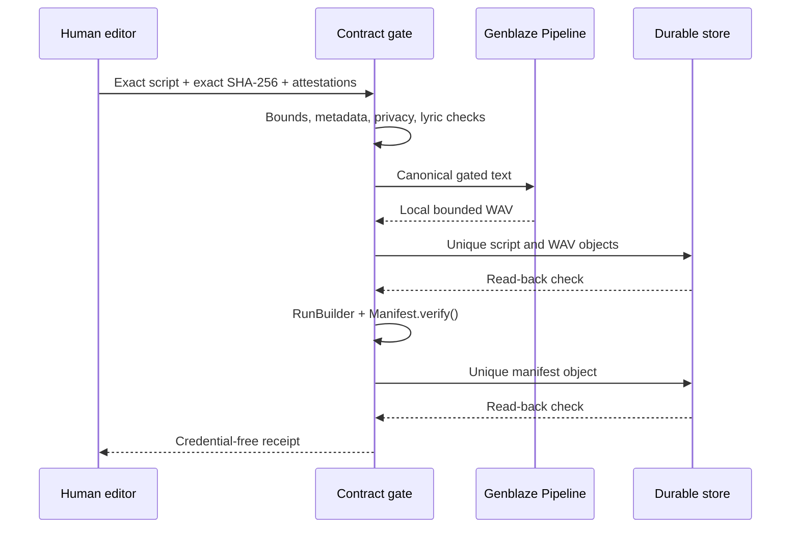

# Architecture

## One responsibility

LONGPLAY RADIO renders continuity copy carrying an approval artifact and
records what the worker did.
An upstream editor owns track selection and approval; the listening surface
owns playback and artist links. This process cannot select a song, retrieve or
generate lyrics, publish a playlist, or move money.



## Rendering

The fake renderer and generic Coqui renderer implement Genblaze's synchronous
provider interface. The same `Pipeline.step(...).run(...)` call invokes either
renderer. Renderer selection and the Coqui executable/model live in operator
configuration, not in the job.

Fake mode generates a deterministic PCM signal derived from the approved
script. It is useful evidence that orchestration works, but it is labeled
`not_speech` in provenance and must not be presented as a voice demo.

The Coqui adapter supports a fixed, generic, single-speaker model. It passes
only `--text`, `--model_name`, and `--out_path`; it provides no route for clone
audio, speaker uploads, arbitrary flags, shell expansion, or post-processing
skins.

## Provenance

The provider Pipeline executes and records the selected rendering path. A
second durable run is assembled after storage because only then are content-bound object
references known. Its steps bind:

1. the approved script artifact, approval hash, and contract digest;
2. the accepted audio artifact, source-text digest, renderer, model, size, and
   duration.

`Manifest.from_run()` creates the manifest and `Manifest.verify()` gates the
receipt. Verification checks internal canonical integrity; it is not a
signature or independent proof of execution authenticity. Separately, the
worker reads every stored asset back and verifies its size and SHA-256. The
receipt keeps both the Genblaze canonical manifest hash and the SHA-256 of the
complete serialized manifest bytes.

## Storage

Keys contain only a public namespace, job/run/object UUIDs, and content hashes:

```text
longplay/genblaze/v1/jobs/{job_uuid}/runs/{run_uuid}/
  assets/{object_uuid}/{sha256}.json
  assets/{object_uuid}/{sha256}.wav
  manifests/{object_uuid}/{manifest_object_sha256}.json
```

Names, artists, scripts, bucket credentials, and local paths never enter keys.
Every key is unique, so retries create candidates rather than overwriting a
previous result.

Local mode atomically creates a write-once path and detects later mutation with
a content-bound read-back token. Direct B2 mode requires an exact version ID
and exact-version GET. Receipts bind an opaque SHA-256 store identity derived
from the local root or B2 region/bucket, so a key and version cannot be
misapplied to a different configured store. The receipt does not contain the
raw name or path.

## Failure semantics

There is no automatic renderer or storage failover. A failed contract,
renderer, read-back, hash, version check, or manifest verification fails the
run. Retrying creates a new run UUID. That keeps cost, voice choice, and
provenance explicit.
